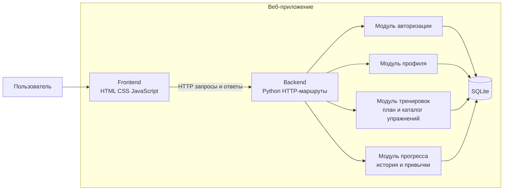

# UML диаграмма компонентов

Диаграмма целевой версии проекта по учебным материалам. Сервер и база данных — запланированные компоненты; ранний HTML-прототип пока работает без них.

## Ответственность компонентов

- **Frontend** показывает страницы, собирает ввод и отображает ответы сервера.
- **Backend** проверяет запросы, применяет бизнес-правила и направляет работу модулей.
- **Авторизация** регистрирует пользователя, проверяет пароль и ограничивает доступ к его данным.
- **Профиль** хранит физические параметры, цели и предпочтения пользователя.
- **Тренировки** содержит каталог упражнений, формирует план и сохраняет ход занятия.
- **Прогресс** читает историю и хранит ежедневные значения привычек.
- **SQLite** сохраняет пользователей, профили, упражнения, планы, результаты и привычки.
