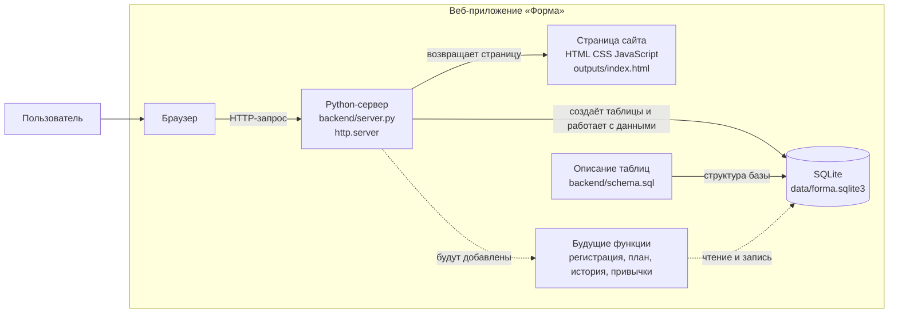

# Диаграмма компонентов

Диаграмма показывает основные части проекта. Сервер и база используют встроенные средства Python. Регистрация и сохранение данных с сайта будут подключаться по мере разработки.

## Что делает каждая часть

- **Страница сайта** — то, что пользователь видит в браузере.
- **Python-сервер** — принимает запросы браузера и возвращает страницу или ответ.
- **Файл `schema.sql`** — описывает таблицы и связи базы данных.
- **SQLite** — файл на компьютере, где будут храниться данные проекта.
- **Будущие функции** — регистрация, анкета, тренировки и трекер привычек; они будут добавляться по плану.
