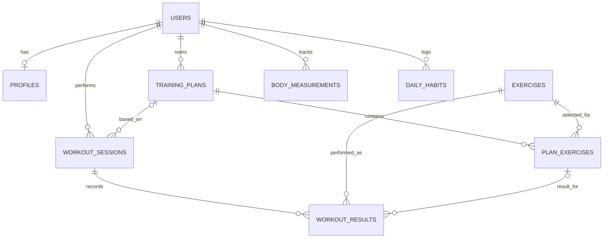

# Модель данных проекта

Таблицы описаны обычным SQL в файле `backend/schema.sql`. При первом запуске Python-сервер создаёт SQLite-файл `data/forma.sqlite3` и выполняет команды из этого файла.

## Таблицы простыми словами

| Таблица | Для чего нужна |
|---|---|
| `users` | Аккаунт: имя, почта и хеш пароля. Пароль нельзя хранить открытым текстом. |
| `profiles` | Ответы анкеты: возраст, рост, вес, цель, опыт, оборудование и ограничения. |
| `exercises` | Название упражнения, описание техники и оборудование. |
| `training_plans` | План тренировок пользователя. |
| `plan_exercises` | Упражнения по дням плана, порядок, подходы и повторения. |
| `workout_sessions` | Отдельное занятие, его дата и статус. |
| `workout_results` | Результат подхода во время занятия. |
| `body_measurements` | Измерения роста и веса по датам. |
| `daily_habits` | Количество воды и шагов за день. |

Числовые идентификаторы связывают таблицы. Например, `profiles.user_id` указывает на владельца анкеты в `users.id`. Внешние ключи включены в SQLite-соединении сервера.
