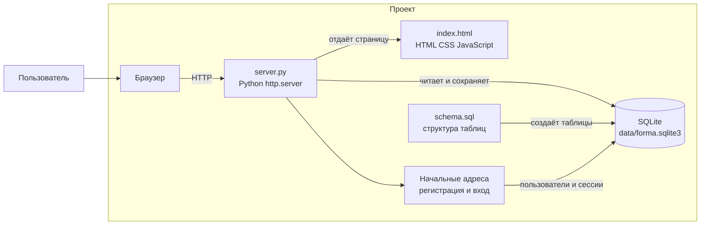

# UML: диаграмма компонентов

Схема показывает части проекта в его текущей структуре. Регистрация и вход добавлены на сервере как начальная работа; формы страницы ещё предстоит с ними связать.

- `index.html` — страница, которую видит пользователь.
- `server.py` — принимает запросы и обрабатывает их на Python.
- `schema.sql` — описывает таблицы.
- SQLite — локальный файл базы данных.
- Следующий шаг — связать экранные формы с серверными адресами.
