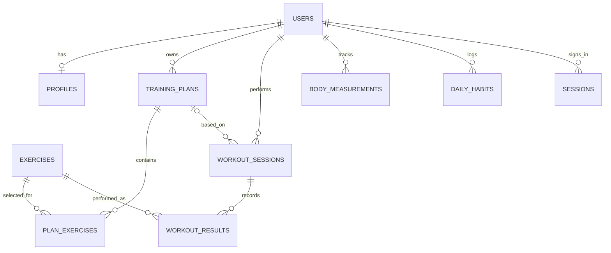

# Модель данных проекта

Таблицы находятся в корневом файле `schema.sql`. При запуске сервера SQLite создаётся в `data/forma.sqlite3`.

| Таблица | Что хранит |
|---|---|
| `users` | Имя, почту и хеш пароля пользователя. |
| `profiles` | Возраст, рост, вес, цель, уровень, частоту занятий и ограничения. |
| `exercises` | Название и инструкцию к упражнению. |
| `training_plans` | План тренировок пользователя. |
| `plan_exercises` | Упражнения, подходы и повторения по дням плана. |
| `workout_sessions` | Дату и статус отдельной тренировки. |
| `workout_results` | Результаты подходов. |
| `body_measurements` | Измерения роста и веса по датам. |
| `daily_habits` | Воду и шаги за день. |
| `sessions` | Временную сессию пользователя после входа. |
