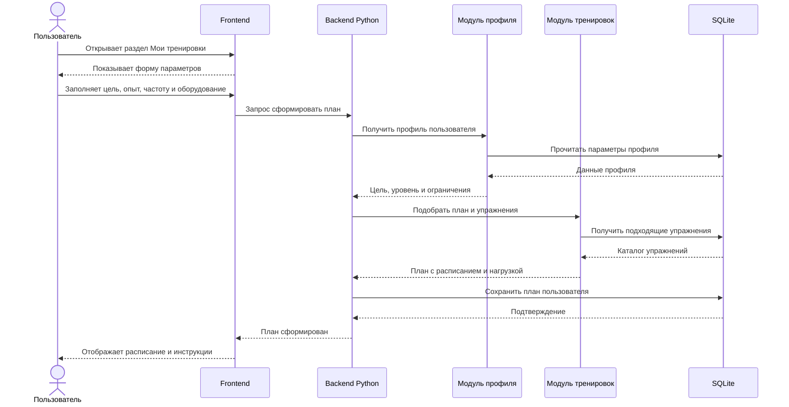
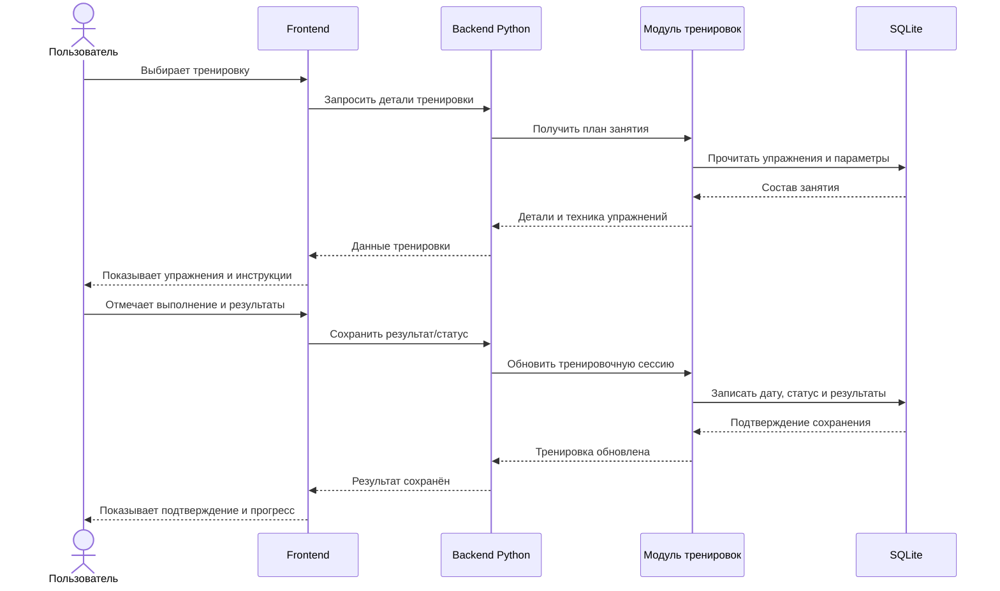
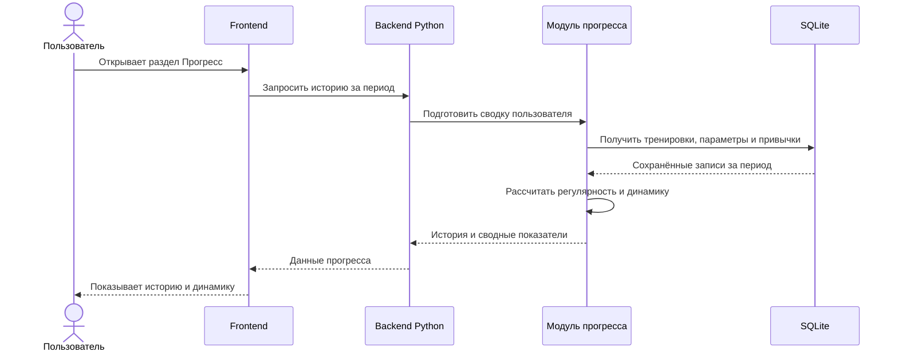

# UML диаграммы последовательностей

Диаграммы описывают три основных сценария из требований: формирование плана, выполнение тренировки и просмотр прогресса. В них показано целевое взаимодействие браузера, Python-сервера, модулей приложения и SQLite.

## Сценарий 1 Формирование индивидуального плана

## Сценарий 2 Выполнение и завершение тренировки

## Сценарий 3 Просмотр прогресса

