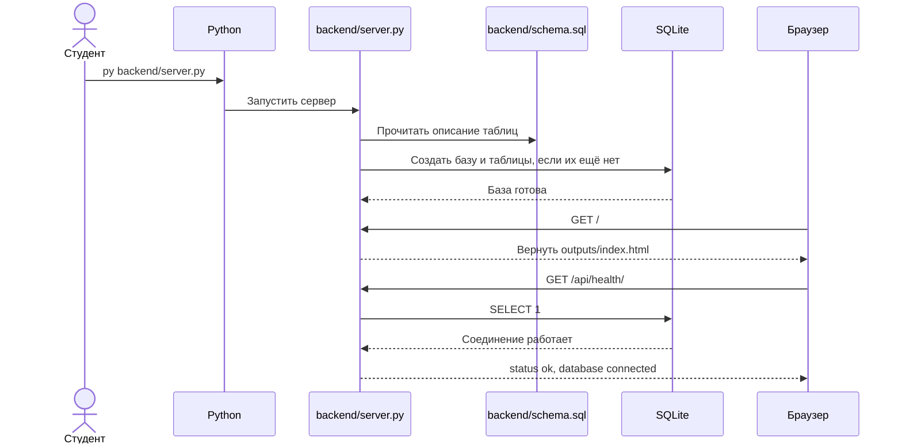
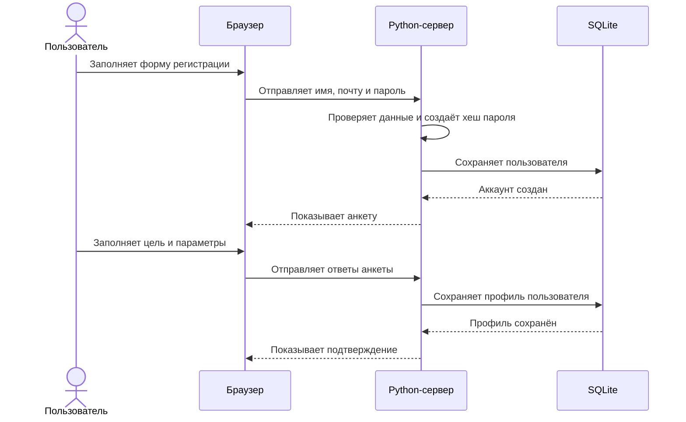
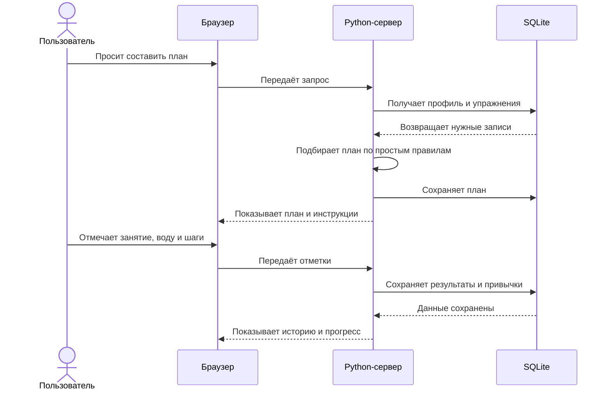

# Диаграммы последовательностей

Первая диаграмма описывает подготовленный каркас. Следующие две показывают запланированные действия пользователя.

## 1. Запуск сайта и создание базы

## 2. Регистрация и заполнение анкеты (будет реализовано)

## 3. План, тренировка и привычки (будет реализовано)

